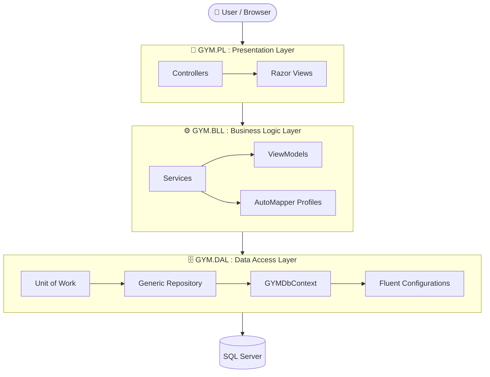
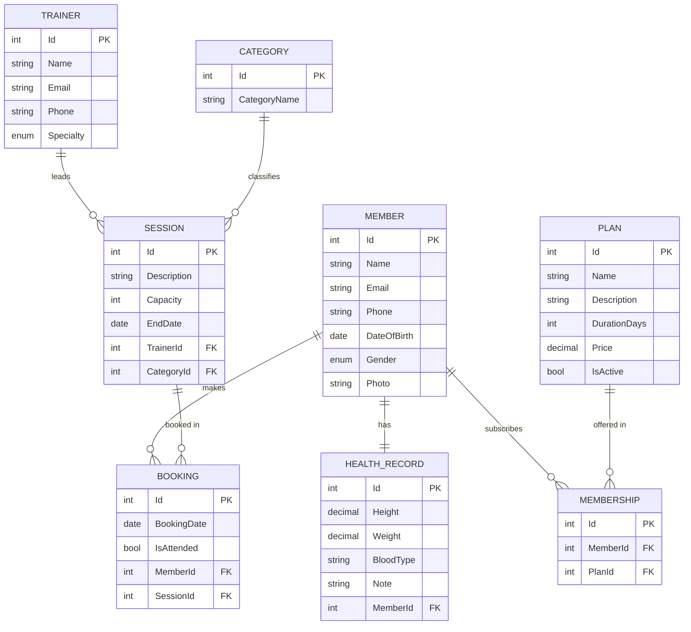

<div align="center">

# 🏋️ GYM Management System

**A full-featured gym management web app built with ASP.NET Core MVC, Entity Framework Core and a clean 3-layer architecture.**

Manage members, trainers, plans, memberships, training sessions and bookings, all from one dashboard.


</div>

---

## 📑 Table of Contents

- [Overview](#-overview)
- [Features](#-features)
- [Tech Stack](#-tech-stack)
- [Architecture](#-architecture)
- [Database Design](#-database-design)
- [Project Structure](#-project-structure)
- [Getting Started](#-getting-started)
- [Learning Journey](#-learning-journey)
- [Author](#-author)

---

## 🌟 Overview

**GYM Management System** helps gym staff run daily operations: registering members with their health records, assigning trainers, publishing membership plans, scheduling sessions by category and tracking who booked and who actually attended.

The home page works as a live **analytics dashboard**, showing total and active members, trainers, and upcoming, ongoing and completed sessions at a glance.

---

## ✨ Features

| Module | What you can do |
|---|---|
| 📊 **Dashboard** | Live stats: total members, active members, trainers, upcoming / ongoing / completed sessions |
| 👤 **Members** | Create, view, edit and delete members, with photo upload and a dedicated **health record** (height, weight, blood type, notes) |
| 🧑‍🏫 **Trainers** | Full CRUD for trainers with specialties: *Strength, Training, Yoga, Nutrition* |
| 📋 **Plans** | Manage membership plans (name, description, duration, price, active status), seeded automatically from `plans.json` |
| 🎫 **Memberships** | Subscribe members to plans and cancel memberships |
| 📅 **Sessions** | Schedule sessions with a trainer, category (*Cardio, Strength, Training, Yoga*), capacity and dates |
| 🗓️ **Sessions Schedule (Booking)** | Book members into sessions, view members for upcoming and ongoing sessions, cancel bookings and mark **attendance** |
| 🔐 **Authentication** | Login / logout with **ASP.NET Core Identity**, an access-denied page, and seeded roles and admin user |
| 📎 **Attachments** | Image upload service for member and trainer photos |

**Under the hood**

- ✅ Generic Repository + **Unit of Work** patterns
- ✅ Service layer with a consistent **Result** pattern (`IsSuccess`, `Data`, `ErrorMessage`)
- ✅ **AutoMapper** for entity ↔ ViewModel mapping
- ✅ Fluent API entity configurations (`IEntityTypeConfiguration<T>`)
- ✅ Async all the way with `CancellationToken` support
- ✅ Automatic **data seeding** on startup (plans from JSON plus Identity roles and admin)
- ✅ Anti-forgery token validation on booking, membership, trainer and login forms
- ✅ Audit fields (`CreateAt`, `UpdateAt`) on every entity through `BaseEntity`

---

## 🛠 Tech Stack

| Layer | Technology |
|---|---|
| **Framework** | .NET 10, ASP.NET Core MVC |
| **Language** | C# |
| **ORM** | Entity Framework Core 10 (Code-First + Migrations) |
| **Database** | Microsoft SQL Server |
| **Auth** | ASP.NET Core Identity (cookie authentication) |
| **Mapping** | AutoMapper |
| **UI** | Razor Views, Bootstrap, custom CSS |

---

## 🏛 Architecture

The solution follows a classic **N-Tier (3-layer) architecture**. Each layer depends only on the layer below it:



| Project | Responsibility |
|---|---|
| **GYM.PL** | MVC controllers, Razor views, static assets, DI setup and startup seeding |
| **GYM.BLL** | Business services (`MemberService`, `TrainerService`, `SessionService`, `BookingService`, `MembershipService`, `AnalyticsService`, `AccountService`, `AttachmentService`), ViewModels and mapping |
| **GYM.DAL** | Entities, `GYMDbContext`, Fluent API configurations, migrations, repositories and Unit of Work |

---

## 🗃 Database Design



> `Member` and `Trainer` both inherit from the abstract `GymUser` (name, email, phone, date of birth, gender, address), which inherits from `BaseEntity` (Id plus audit fields).

---

## 📂 Project Structure

```
Gym_Project/
├── GYM.PL.slnx                     # Solution file
│
├── GYM.PL/                         # 🎨 Presentation Layer
│   ├── Controllers/                # Account, Booking, Home, Member, Membership, Plan, Session, Trainer
│   ├── Views/                      # Razor views per controller + shared layout
│   ├── wwwroot/
│   │   ├── css/  js/  images/      # Static assets
│   │   └── Files/plans.json        # Seed data for plans
│   ├── Program.cs                  # DI, Identity, seeding, middleware pipeline
│   └── appsettings.json            # Connection string
│
├── GYM.BLL/                        # ⚙️ Business Logic Layer
│   ├── Common/                     # Result / Result<T>
│   ├── Mapping/                    # One AutoMapper profile per feature folder
│   │   └── Bookings/  Members/  Memberships/  Plans/  Sessions/  Trainers/  Common/
│   ├── Services/
│   │   ├── Interfaces/             # IMemberService, ... (one folder + namespace per feature)
│   │   ├── Classes/                # MemberService, ...  (one folder + namespace per feature)
│   │   │   └── Account/  Analytics/  Attachments/  Bookings/  Members/
│   │   │       Memberships/  Plans/  Sessions/  Trainers/
│   │   └── Helpers/                # Shared helpers
│   └── ViewModels/                 # One class per file, one namespace per folder
│       └── Account/  Analytics/  Bookings/  Members/  Memberships/  Plans/  Sessions/  Trainers/
│
└── GYM.DAL/                        # 🗄️ Data Access Layer
    ├── Data/
    │   ├── Models/                 # Entities (Member, Trainer, Plan, Session, ...)
    │   ├── Enums/                  # Gender, Specialties, CategoryNames
    │   ├── Configurations/         # Fluent API configurations
    │   ├── GymDbContext/           # GYMDbContext
    │   └── Migrations/             # EF Core migrations
    └── Repositories/               # Generic Repository + Unit of Work
```

---

## 🚀 Getting Started

### Prerequisites

- [.NET 10 SDK](https://dotnet.microsoft.com/download)
- SQL Server (LocalDB, Express or Developer edition)
- Visual Studio 2022+ / VS Code / Rider

### Installation

1. **Clone the repository**
   ```bash
   git clone https://github.com/ahmedramzyelsheikh/Gym_Project.git
   cd Gym_Project
   ```

2. **Configure the database connection** in `GYM.PL/appsettings.json`
   ```json
   "ConnectionStrings": {
     "DefaultConnection": "Server=.;Database=GymOrginalDB;Trusted_Connection=True;TrustServerCertificate=True;"
   }
   ```

3. **Run the app**
   ```bash
   dotnet run --project GYM.PL
   ```

On first run, the app automatically:

- applies all EF Core **migrations** (creates the database if it doesn't exist)
- seeds the session **categories** and the **membership plans** from `wwwroot/Files/plans.json`
- creates the **Identity roles** (`Admin`, `Receptionist`) and a default admin account

### 🔑 Default login

| Email | Password |
|---|---|
| `admin@gym.com` | `Admin@123` |

> ⚠️ Change this password before using the app anywhere other than your own machine.

> ℹ️ The project uses **AutoMapper 16**, which asks for a license key. It works without one and only logs a warning. A free community license is available at [automapper.io](https://automapper.io).

---

## 🧭 Learning Journey

This project was built step by step. Each branch captures one milestone:

| Branch | Milestone |
|---|---|
| `session-02` | 🏗️ Initial project setup and 3-layer solution structure |
| `sessio-03` | 📦 Core modules: Plans, Members, Trainers |
| `session-04` | 📊 Analytics dashboard, Session CRUD, Unit of Work, data seeding, AutoMapper and the Result pattern |
| `session-07` | 🔐 ASP.NET Core Identity and attachments (photo uploads) |
| `task-07` | 🎯 Full project: Bookings, Memberships and attendance tracking |
| `main` | ✅ Final, complete version |

---

## 👨‍💻 Author

<div align="center">

**Ahmed Ramzy**

[](https://github.com/ahmedramzyelsheikh)

⭐ If you like this project, give it a star!

</div>
